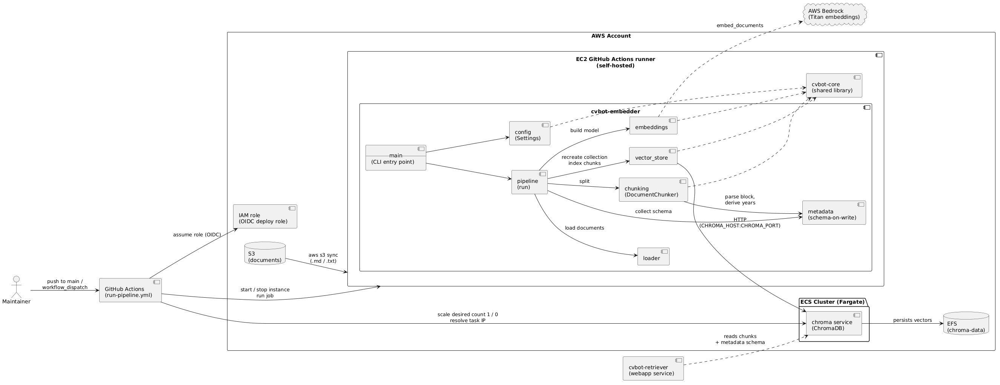
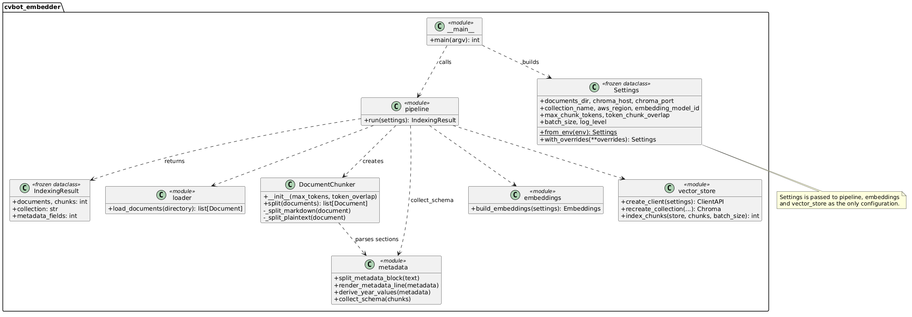
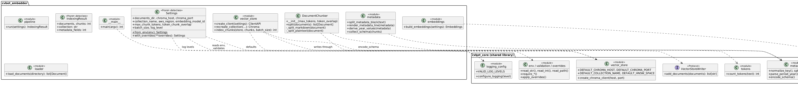
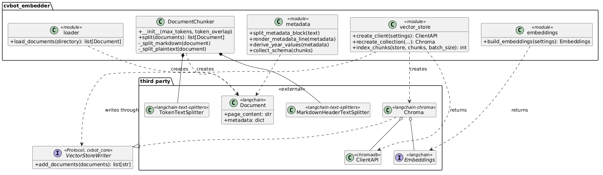
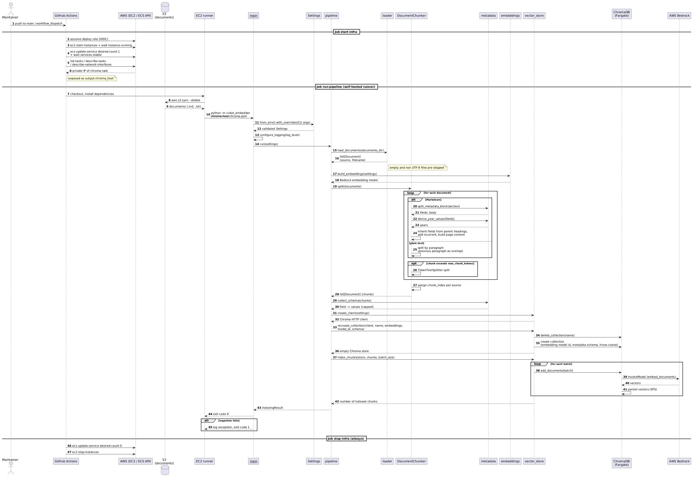

# cvbot-embedder

Ingestion pipeline of the CVBot RAG system: it turns local Markdown documents into embeddings and indexes them in ChromaDB.

## Overview

CVBot is a personal RAG chatbot that answers questions about its owner's CV. This repository contains the ingestion side: it loads the CV documents, splits them into chunks, parses the section metadata, embeds the chunks with AWS Bedrock and rebuilds a ChromaDB collection that cvbot-retriever queries.

**Tools:** Python 3.13, LangChain (`langchain-core`, `langchain-text-splitters`, `langchain-aws`, `langchain-chroma`), ChromaDB, boto3, tiktoken, cvbot-core

**AWS components:**

| Component | Role |
| --- | --- |
| S3 | Holds the source documents. |
| EC2 (self-hosted GitHub Actions runner) | Runs the pipeline inside the VPC, where ChromaDB is reachable. |
| ECS Fargate (ChromaDB) | Stores the vectors; data is persisted on EFS. |
| Bedrock (Titan Text Embeddings V2) | Creates the embeddings. |

The infrastructure itself is provisioned by cvbot-infra.



## Design decisions

The system is a proof of concept and a showcase: it does not need to be production ready or permanently online, should balance own code against managed services, and should be as cheap as possible. That leads to several deviations from a typical RAG ingestion:

| Typical RAG setup | Here | Reason |
| --- | --- | --- |
| Incremental updates with change tracking | The collection is dropped and rebuilt on every run | Simple and idempotent; the corpus is small enough that a full rebuild is cheap. |
| Generic fixed-size chunking | Format-aware chunking by Markdown headers, token split only for oversized chunks | Keeps each CV section intact and carries its heading path with it. |
| Metadata extracted by an LLM at index time | Schema-on-write: authors write `> key: value` lines below a heading | Deterministic and free of LLM cost; the retriever can filter on exactly these fields. |
| Retriever configured separately from the index | Embedding model ID and observed metadata schema are stored in the collection metadata | The retriever picks the matching model and filter fields from the index itself, so both sides cannot drift apart. |

## Limitations

- The collection is deleted and recreated on every run: no incremental updates, and the retriever sees an empty or partial index while a run is in progress.
- Documents must be available locally; the workflow copies the S3 bucket to the runner. Only `.md` and `.txt` files are read.
- Token counting uses `cl100k_base` as an approximation of the Titan tokenizer.
- Metadata blocks are only recognised below `#`, `##` and `###` headings; the published schema and the derived years are capped.
- Changing the embedding model requires a full rebuild, since vectors of different models are not comparable.

## Architecture

| Module / class | Purpose |
| --- | --- |
| `__main__` | Command line entry point; builds `Settings` from environment and CLI arguments, configures logging, runs the pipeline and returns the exit code. |
| `pipeline` | Orchestrates one ingestion run and returns an `IndexingResult`. |
| `Settings` | Frozen dataclass with the validated configuration, read from environment variables and CLI overrides. |
| `IndexingResult` | Frozen dataclass with the metrics of a run (documents, chunks, collection, metadata fields). |
| `loader` | Reads the `.md` and `.txt` files of a directory into LangChain documents. |
| `DocumentChunker` | Splits documents format-aware (Markdown by headers, text by paragraphs) and token-bounded; applies metadata inheritance and derived fields. |
| `metadata` | Parses the `> key: value` blocks, renders them back into the chunk text, derives `years` and collects the metadata schema. |
| `embeddings` | Builds the Bedrock embedding model from the settings. |
| `vector_store` | Creates the ChromaDB client, recreates the collection with its metadata and writes the chunks in batches. |







## Workflow

1. `Settings` is built from environment variables and CLI overrides and validated.
2. The documents are loaded from the documents directory.
3. The Bedrock embedding model is created.
4. `DocumentChunker` splits the documents: Markdown by headers, text by paragraphs. Section metadata is parsed, inherited from parent headings, extended by `years` and `iscurrent`, and rendered into the chunk text. Chunks above `MAX_CHUNK_TOKENS` are split by tokens, then each chunk gets a `chunk_index`.
5. The metadata schema is collected from all chunks.
6. The ChromaDB collection is deleted and created again, storing the embedding model ID and the metadata schema in its metadata.
7. The chunks are embedded with Bedrock on the runner and written to ChromaDB in batches.
8. The run result is logged; any exception ends the run with exit code `1`.



## Section metadata

A section declares metadata in blockquote lines directly below its heading:

```markdown
## ACME Inc.
> type: employer
> startdate: 2011-10
> enddate: 2022-10

Actual chunk text...
```

- Keys are normalized (lowercase, umlauts folded); values are split on `,` and `;`.
- Fields cascade to deeper sections until a deeper section overrides them.
- `years` and `iscurrent` are derived from `startdate` / `enddate` (an open or missing `enddate` runs up to the current year); manually maintained values win.
- `source`, `filename`, `chunk_index` and `h1`-`h3` are reserved.
- Key-value-pairs can be chosen freely to provide the best results for your usecase.

## Setup

1. **Infrastructure:** provision cvbot-infra first. It creates the runner, which registers itself on this repository, the ChromaDB service, the documents bucket and the OIDC deploy role.
2. **AWS access:** the workflow requests `permissions: id-token: write` and assumes the role from `AWS_DEPLOY_ROLE_ARN` via OIDC. No AWS keys are stored in this repository.
3. **Variables:** after the first infrastructure apply, copy the created resource names and IDs into the repository variables listed below.
4. **Diagram push:** the `render-diagrams` job commits the rendered `docs/*.png`. Register a GitHub App, install it on this repository with the **Contents: Read and write** permission and store its credentials as repository secrets **`APP_ID`** and **`APP_PRIVATE_KEY`** (same approach as in cvbot-core).
5. **Documents and Bedrock:** upload the Markdown documents to the S3 bucket and enable Bedrock access to Titan Text Embeddings V2 in the target region.

## Environment variables

Set as GitHub repository **variables** unless marked as secret. The workflow defines no defaults, so all of them are **required** (the secrets only for `render-diagrams`). Variables marked **shared** must be set identically in the named repository. The pipeline's own settings (e.g. `CHROMA_COLLECTION`, `EMBEDDING_MODEL_ID`) are not set by the workflow and use their code defaults, which match cvbot-infra and cvbot-retriever.

| Name | Purpose | Shared |
| --- | --- | --- |
| `AWS_REGION` **required** | Region of Bedrock, EC2 and ECS. | **shared** with cvbot-infra and cvbot-retriever |
| `AWS_DEPLOY_ROLE_ARN` **required** | Role assumed via OIDC to start and stop the infrastructure. | **shared** with cvbot-retriever |
| `EC2_INSTANCE_ID` **required** | Runner instance that is started before and stopped after a run. | |
| `ECS_CLUSTER` **required** | ECS cluster that hosts the ChromaDB service. | **shared** with cvbot-retriever |
| `ECS_SERVICE` **required** | ChromaDB service that is scaled up and down. | **shared**: equals `ECS_CHROMA_SERVICE` in cvbot-retriever |
| `RUNNER_LABEL` **required** | Label that selects the self-hosted runner. | **shared**: equals `runner_label` in cvbot-infra |
| `S3_BUCKET` **required** | Bucket the documents are synced from. | |
| `CHROMA_PORT` **required** | Port of ChromaDB, passed to the pipeline. | **shared**: equals `chroma_port` in cvbot-infra and `CHROMA_PORT` in cvbot-retriever |
| `APP_ID` (secret) **required** | ID of the GitHub App that pushes the rendered diagrams. | |
| `APP_PRIVATE_KEY` (secret) **required** | Private key of that GitHub App. | |
